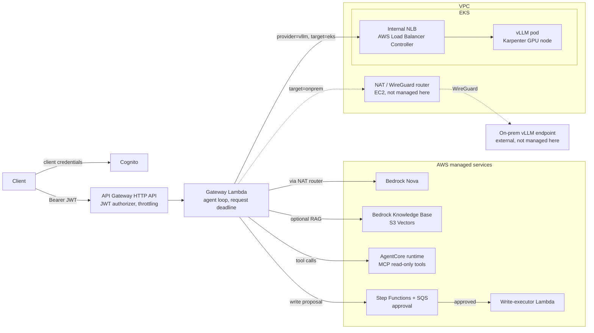

# Enterprise AI Platform on AWS

A lab-scale but production-shaped AI platform on AWS. Internal applications call **one authenticated API** and get an agent that answers from **Amazon Bedrock** or from a **self-hosted vLLM** model on **EKS GPU nodes**, with optional RAG, tool calling over MCP, human approval for write actions, request deadlines and CloudWatch observability.

It is an infrastructure and platform engineering project. The application code is deliberately small; the interesting parts are the Terraform, the networking, GPU scheduling, failure handling and the measurements.

> Status: a personal lab, built and exercised on one AWS account. It is not a hardened product. The [project status](#project-status) table says exactly what has been validated and what has not.

## Problems it addresses

- **One entry point for many model backends.** Callers send a prompt; the platform decides how it is served (managed Bedrock or self-hosted vLLM) behind the same auth, limits and response shape.
- **Self-hosting cost and latency, measured rather than assumed.** GPU nodes scale from zero with Karpenter; cold start, pod failure and node failure were timed and the raw captures kept.
- **Bounded requests.** Every downstream call gets `min(component maximum, time left)` of one request budget kept below the Lambda and API Gateway limits, and the response names the component that ran out of time.
- **Safe tool use.** The model may read through MCP tools, but a write action only runs after a human approves it.

## Architecture



More detail: [docs/architecture.md](docs/architecture.md).

## Request flow

1. The client gets a token from Cognito with the OAuth client-credentials flow (scope `enterprise-ai-gateway/invoke`).
2. API Gateway validates the JWT and applies stage throttling (default 5 requests/s, burst 10), then invokes the gateway Lambda.
3. The Lambda creates the request budget: 24 s, minus time spent queued before it started, and never more than the Lambda's own remaining time minus a 6 s reserve.
4. Optional RAG: retrieve from the Bedrock Knowledge Base before the model call (any provider).
5. The agent loop (up to 5 steps) calls the model through one adapter:
   - `provider=bedrock`: Bedrock `Converse` (Nova Micro for `fast`, Nova Lite for `quality`).
   - `provider=vllm`: OpenAI-compatible `/v1/chat/completions`. `target=eks` (default) finds the internal NLB at runtime by its Kubernetes service tag; `target=onprem` uses `ONPREM_VLLM_BASE_URL`.
6. Tool calls go to the MCP server on AgentCore (read-only tools). A proposed write starts a Step Functions execution and the API returns `202`; `scripts/approve.py` approves or rejects it, and only then does the write-executor Lambda run it.
7. The response carries the answer, timings and, on failure, a controlled error such as `504 request_deadline_exceeded` with the component and step.

## Components

| Component | Responsibility | Where |
|---|---|---|
| Cognito user pool, M2M client, resource server | Machine-to-machine auth, `invoke` scope | `terraform/environments/dev/app/cognito.tf` |
| API Gateway HTTP API | JWT authorizer, `POST /invoke`, stage throttling | `app/apigateway.tf` |
| Gateway Lambda (Python 3.12, in the VPC) | Agent loop, model adapter, deadline, metrics | `gateway/lambda/`, `app/lambda.tf`, `app/network.tf` |
| Bedrock Knowledge Base on S3 Vectors | RAG over `data/` | `app/bedrock_knowledge_base.tf`, `app/rag_*.tf` |
| AgentCore runtime | MCP read-only tools (Lambda configuration and logs) | `mcp-agentcore/`, `app/agentcore*.tf` |
| Step Functions, SQS, write-executor Lambda | Human approval for write actions | `app/approval.tf`, `app/write_executor.tf`, `write-executor/` |
| EKS cluster (1.36) and a `t3.medium` system node group | Control plane, CoreDNS, VPC CNI, Pod Identity | `terraform/environments/dev/eks/` |
| Karpenter 1.15.1 and a GPU NodePool | GPU nodes on demand, scale to zero | `eks-addons/karpenter*.tf`, `eks-addons/charts/karpenter-gpu/` |
| NVIDIA device plugin 0.20.1 | Advertises `nvidia.com/gpu` | `eks-addons/nvidia_device_plugin.tf` |
| AWS Load Balancer Controller 3.6.2 | Creates the internal NLB for the vLLM Service | `eks-addons/aws_lbc.tf`, `eks-addons/inference_nlb.tf` |
| vLLM Deployment and Service | `Qwen/Qwen2.5-7B-Instruct` on `vllm/vllm-openai:v0.33.0` | `eks-addons/manifests/` |
| CloudWatch Observability add-on and dashboard | vLLM, GPU, cluster metrics; one dashboard | `eks-addons/cloudwatch_observability.tf`, `app/dashboard.tf` |

## Repository layout

```text
.github/workflows/ci.yml     Static checks: terraform fmt/validate, helm lint, pytest, bash -n
terraform/environments/dev/
  app/                       Cognito, API Gateway, gateway Lambda, RAG, AgentCore, approval, network rules, dashboard
  eks/                       EKS cluster, system node group, core add-ons
  eks-addons/                Karpenter, GPU NodePool, NVIDIA device plugin, Load Balancer Controller,
                             CloudWatch Observability add-on, manifests/ (vLLM Deployment and Service)
gateway/lambda/              Handler, agent loop, model adapter, vLLM client, RAG, MCP client, deadline, metrics
gateway/tests/               Unit tests against fakes (no AWS, GPU or network needed)
mcp-agentcore/               MCP tool server deployed to AgentCore
write-executor/              Lambda that runs an approved write action
scripts/                     up.sh, down.sh, approve.py, measurement and load-test tooling, repro/ (local reproductions)
data/                        Documents ingested into the Knowledge Base
docs/                        Architecture, known limitations, decisions/, experiments/ (reports and raw results)
```

## Prerequisites

- An AWS account and CLI profile; Terraform `>= 1.7, < 2.0`; `kubectl`; `helm` (for linting only); AWS CLI v2; Python 3.12.
- Bedrock model access to Amazon Nova Micro and Nova Lite and to the embedding model used by the Knowledge Base.
- Service quota for one `g5.xlarge` (4 vCPUs of "Running On-Demand G and VT instances").
- **A private subnet for the Lambda whose default route goes through a self-managed NAT/router EC2 instance**, plus that instance's network interface ID. This lab used a WireGuard host. The repo does not create it; for anything beyond a lab, use a NAT gateway or VPC endpoints instead.

## Deploy

1. Copy each stack's example and fill in your values (the real files are git-ignored):

   ```bash
   for s in app eks eks-addons; do
     cp terraform/environments/dev/$s/terraform.tfvars.example terraform/environments/dev/$s/terraform.tfvars
   done
   cp .env.example .env    # optional: AWS_PROFILE and the account guard for the scripts
   ```

2. Preview and run. Each stack is applied with a plain `terraform apply` that stops at Terraform's own approval prompt:

   ```bash
   scripts/up.sh --dry-run     # preview the steps
   scripts/up.sh               # app -> eks -> eks-addons -> vLLM manifests
   scripts/up.sh --wait        # also wait for the vLLM pod (10+ minutes on a fresh GPU node)
   ```

   `up.sh` checks that the AWS profile belongs to the expected account before doing anything, and renders the Service manifest with the cluster's subnets.

3. Tear down when you are not testing (the GPU node, EKS control plane, system node and NAT instance all bill while they exist):

   ```bash
   scripts/down.sh --dry-run
   scripts/down.sh             # Service -> Deployment/GPU pool -> eks-addons -> eks -> app
   scripts/down.sh --keep-app  # keep the API, remove EKS
   ```

   The order matters: the vLLM Service is deleted first and the script waits for its load balancer to disappear. Destroying the controller first leaves an orphaned NLB that Terraform does not know about. Deleting the app stack can wait up to about 40 minutes for AWS to release the Lambda's network interfaces.

## Try it

```bash
cd terraform/environments/dev/app
TOKEN=$(curl -s -u "$(terraform output -raw m2m_client_id):$(terraform output -raw m2m_client_secret)" \
  -d grant_type=client_credentials -d scope=enterprise-ai-gateway/invoke \
  "$(terraform output -raw cognito_token_endpoint)" | python3 -c 'import sys,json; print(json.load(sys.stdin)["access_token"])')

curl -s -X POST "$(terraform output -raw invoke_url)" \
  -H "authorization: Bearer $TOKEN" -H 'content-type: application/json' \
  -d '{"prompt": "Say hi in five words", "provider": "bedrock", "model_class": "fast"}'
```

Request fields: `prompt` (required), `provider` (`bedrock` or `vllm`), `target` (with `provider=vllm`: `eks`, the default, or `onprem`), `model_class` (`fast` or `quality`, Bedrock only), `rag` (`true` to retrieve first).

## Configuration

**Terraform variables you must set** (no defaults, kept in each stack's git-ignored `terraform.tfvars`):

| Variable | Stacks | Meaning |
|---|---|---|
| `allowed_account_ids` | all | Terraform refuses to run against any other account |
| `vpc_id` | all | VPC holding the router, the Lambda subnet and the EKS subnets |
| `lambda_subnet_ids` | app | Private subnet(s) for the Lambda, routed through the router |
| `wireguard_eni_id` | app | Network interface of the NAT/WireGuard router |

**Useful optional variables:** `api_throttling_rate_limit` / `api_throttling_burst_limit` (5 / 10), `onprem_vllm_base_url`, `inference_port` (8000), `gpu_instance_type` (`g5.xlarge`), `eks_public_access_cidrs` (default `0.0.0.0/0`; restrict it), `lambda_timeout` (30), and the pinned chart/add-on versions in `eks-addons/variables.tf`.

**Lambda environment** (set by Terraform): `KNOWLEDGE_BASE_ID`, `AGENTCORE_RUNTIME_ARN`, `APPROVAL_STATE_MACHINE_ARN`, `VLLM_PORT`, `ONPREM_VLLM_BASE_URL`. Optional: `REQUEST_TIMEOUT_SECONDS` (request budget, default 24) and `VLLM_BASE_URL` (debug override for every vLLM target). Component maximums are in `gateway/lambda/config.py`.

**Scripts** (`.env`, optional): `AWS_PROFILE`, `EXPECTED_AWS_ACCOUNT_ID` (falls back to `allowed_account_ids` in the app stack's `terraform.tfvars`), `VLLM_NLB_SUBNETS` (falls back to the cluster's subnets).

## GPU scheduling and scaling

- **Scale from zero.** There is no GPU node until a pod asks for `nvidia.com/gpu`. Karpenter then launches one on-demand `g5.xlarge` (AL2023 AMI, 100 GiB root volume) from the `gpu` NodePool.
- **Isolation.** GPU nodes carry the taint `nvidia.com/gpu=true:NoSchedule` and the label `workload=gpu`; only the vLLM pod tolerates and selects them. The system node group runs everything else.
- **Boundaries.** The NodePool is capped at 4 vCPUs and 1 GPU, matching the account quota. `expireAfter: 24h`; an empty node is consolidated after 30 s, so deleting the Deployment stops GPU billing within about a minute.
- **Serving.** One vLLM replica, `--max-model-len 8192`, tool calling with the `hermes` parser, readiness probe on `/health` (failure threshold 3). The Hugging Face cache is an `emptyDir`, so weights are downloaded again on every new pod.
- **Not implemented:** replica autoscaling (HPA/KEDA on vLLM metrics), multi-GPU or multi-node serving, KServe. Why autoscaling is deferred: [docs/decisions/vllm-cold-start-and-autoscaling.md](docs/decisions/vllm-cold-start-and-autoscaling.md).

## Observability and measurements

- **Gateway metrics.** The Lambda emits CloudWatch EMF metrics per request: `RequestCount`, `RequestLatency`, `ModelLatency`, `TimeoutCount`, `ErrorCount` (namespace `EnterpriseAIPlatform/Gateway`), plus structured logs with per-stage timings.
- **vLLM, GPU and cluster metrics.** The `amazon-cloudwatch-observability` EKS add-on (OpenTelemetry mode) scrapes vLLM and manages the DCGM exporter. The dashboard has 11 widgets; the vLLM, GPU and cluster widgets are PromQL marked `[draft query]` and have not been checked against live series.
- **Measured** (raw captures in [docs/experiments/results/](docs/experiments/results/)):

  | Measurement | Result | Report |
  |---|---|---|
  | Cold start on a fresh GPU node, to pod Ready | 701 s (image pull about 299 s, model start about 347 s, node about 41 s) | [vllm-cold-start.md](docs/vllm-cold-start.md) |
  | Pod failure to first successful request | 369 s | [vllm-failure-recovery.md](docs/experiments/vllm-failure-recovery.md) |
  | GPU node failure, replacement pod to first successful request | about 21 min (failure start not captured; delayed by `VcpuLimitExceeded`) | same |

- **Not yet measured:** concurrency limits, TTFT, TPOT, throughput, p95 latency under load, GPU utilization and KV-cache behaviour. Tooling for an on-prem load test is ready ([docs/experiments/onprem-vllm-load-test.md](docs/experiments/onprem-vllm-load-test.md)); full GPU load testing is postponed while GPU capacity is limited. No benchmark numbers are claimed.

## Security controls

- **Authentication:** Cognito client-credentials tokens; API Gateway JWT authorizer requires the `invoke` scope. The client secret is a sensitive Terraform output.
- **Rate limiting:** stage throttling (configurable, default 5 requests/s, burst 10), so excess calls get `429` before any model cost.
- **Network:** the Lambda runs in a private subnet. Its security group allows only HTTPS out, the vLLM port to the NLB security group, and the on-prem vLLM port to that one address. The vLLM NLB is internal and accepts traffic only from the Lambda security group.
- **Least privilege:** per-function IAM roles with inline policies scoped to the resources they use; no `AdministratorAccess`. `"*"` appears only for read-only actions that do not support resource-level permissions (`tag:GetResources`, `elasticloadbalancing:DescribeLoadBalancers`, `logs:DescribeLogGroups`). Exception: the CloudWatch agent uses the AWS-managed `CloudWatchAgentServerPolicy`.
- **Write actions need a human.** The model only proposes writes; Step Functions waits for an explicit approval.
- **Data:** S3 buckets block public access and use server-side encryption. Structured logs record timings and error codes, not prompt text or tokens.
- **Guard rails for operators:** `allowed_account_ids` in every provider; `up.sh`/`down.sh` refuse to run against another account.
- **Repository hygiene:** state, `terraform.tfvars`, `.env` and keys are git-ignored. No credentials were found in the history.

## Architecture decisions

| Decision | Why | Alternatives considered |
|---|---|---|
| Three Terraform stacks (`app`, `eks`, `eks-addons`), local state | Plain `terraform apply` with no `-target`; the API can live without the cluster; small blast radius ([decision](docs/decisions/terraform-stacks.md)) | One root with `-target` (fragile); Terragrunt (more tooling than the problem needs) |
| Lambda + API Gateway for the gateway | No servers for a bursty, low-volume API; native JWT authorizer and throttling | ECS/Fargate or a pod in EKS (always-on cost, more to operate) |
| Bedrock and vLLM behind one adapter | Compare managed and self-hosted serving with the same RAG, tools and approval | Separate APIs per backend |
| vLLM on EKS with Karpenter | Pay for a GPU only while a pod needs it; fast, flexible node provisioning | Managed GPU node group (slower and coarser scaling); SageMaker endpoints (less control over the runtime) |
| Internal NLB found at runtime by tag | The Lambda never needs redeploying when the NLB is recreated | Service discovery through the cluster, or a fixed DNS name |
| CloudWatch-only observability | One place for Lambda, EKS, vLLM and GPU metrics; no extra servers ([decision](docs/decisions/observability.md)) | Self-managed Prometheus and Grafana |
| KServe not used | One model and one replica do not need its abstractions yet ([decision](docs/decisions/vllm-cold-start-and-autoscaling.md)) | KServe or KServe with Knative, worth revisiting with several models or scale-to-zero per model |

## Operational considerations

- **Failure handling.** One request budget across all calls; controlled `504` responses that name the component. A real outage showed vLLM calls overrunning the budget; the probable cause (urllib giving every NLB address a full timeout) is fixed in code and awaits a live re-test ([known limitations](docs/known-limitations.md#timeout-gap)).
- **Single points of failure.** One vLLM replica on one GPU node (every pod or node failure is a full outage of the vLLM path until a replacement is Ready), and one self-managed NAT/router instance for the Lambda's outbound traffic.
- **Cost.** The GPU node is the largest cost and is billed only while vLLM is deployed. The EKS control plane, system node and NAT instance bill while the stacks exist. Bedrock is billed per token.
- **Trade-offs.** Scale-to-zero saves money but means a cold start of about 12 minutes. The 4-vCPU GPU quota blocks a second replica and slowed node-failure recovery.

## Project status

| Capability | Status | Evidence |
|---|---|---|
| Authenticated API, throttling, Bedrock inference, model adapter | Implemented and validated | Code, tests, live runs ([build log](docs/progress.md)) |
| Self-hosted vLLM on EKS (Karpenter GPU, NLB, runtime discovery) | Implemented and validated | Full-path request and cold-start run ([report](docs/vllm-cold-start.md)) |
| Cold start, pod failure and node failure recovery | Measured | [experiments](docs/experiments/vllm-failure-recovery.md) |
| RAG, MCP tools via AgentCore, approval for writes | Implemented, partly validated | Unit tests against fakes; no live end-to-end run recorded |
| Per-request target routing (`eks` / `onprem`) | Implemented, partly validated | Unit tests. A live on-prem request ended at the deadline; the missing security-group rules are now in Terraform but not re-tested |
| Request deadline | Implemented; live re-test pending | Unit and reproduction tests; see [known limitations](docs/known-limitations.md) |
| CloudWatch dashboard (vLLM/GPU/cluster widgets) | Implemented, not validated | PromQL drafts not checked against live series |
| GPU load test (concurrency, TTFT, TPOT, throughput, p95, KV cache) | Postponed | Tooling ready; no results |
| `1 -> 2` GPU autoscaling, readiness-failure test | Postponed | GPU quota; test designed, not run |
| KServe, alarms, tracing, CI deploys, remote state | Not implemented | |

## Tests and CI

```bash
python3.12 -m venv .venv
.venv/bin/pip install -r gateway/lambda/requirements.txt boto3 pytest
(cd gateway && ../.venv/bin/python -m pytest tests -q)   # gateway: fakes only, no AWS
.venv/bin/python -m pytest scripts/tests -q             # measurement and load-test tooling
```

GitHub Actions ([.github/workflows/ci.yml](.github/workflows/ci.yml)) runs `terraform fmt -check` and `validate` for each stack, `helm lint`, both test suites and a shell syntax check. It uses no AWS credentials and deploys nothing.

## Known limitations

The active list, with evidence, is in [docs/known-limitations.md](docs/known-limitations.md). In short: GPU quota of 4 vCPUs; single replica; about 12-minute cold start; local Terraform state; a self-managed NAT instance; unverified dashboard queries; the deadline fix awaiting a live re-test; the EKS public endpoint open to `0.0.0.0/0` by default (IAM auth still applies).

## Future improvements

- Run the GPU load test and record concurrency, TTFT, TPOT, throughput, p95 latency and KV-cache behaviour.
- Remote Terraform state (S3 with locking).
- Replace the NAT instance with a NAT gateway or VPC interface endpoints (Bedrock, AgentCore, Step Functions).
- Faster cold start: pre-pulled image and a persistent model store instead of an `emptyDir` cache.
- A second replica and metric-driven autoscaling once GPU quota allows; then re-evaluate KServe.
- Alarms on the existing metrics, tracing, and validated dashboard queries.
- A narrower IAM policy for the CloudWatch agent; restrict `eks_public_access_cidrs`.

## License

[MIT](LICENSE)
