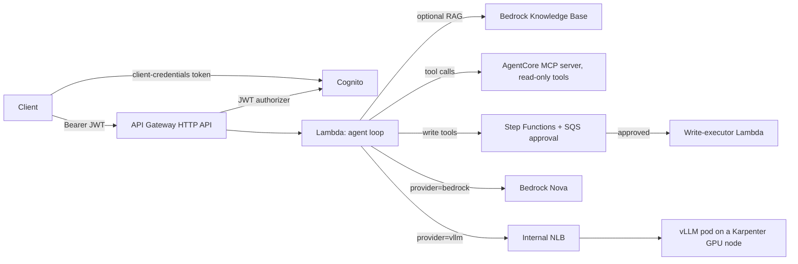

# Enterprise AI Platform

A learning-grade but production-shaped AI platform on AWS. Internal applications call one authenticated API and get an agent that can answer from **Amazon Bedrock** or from a self-hosted **vLLM** model on **EKS GPU nodes**, with optional RAG, tool calling over MCP, human approval for write actions, and CloudWatch observability.

It is an infrastructure and platform engineering project: the application code is deliberately small, and the interesting parts are the Terraform, the networking, the failure handling and the operations.

## Architecture



## What it does

- **Auth:** Cognito machine-to-machine client, JWT authorizer on the API.
- **Agent loop:** one Lambda runs the model/tool loop. A model adapter gives Bedrock and vLLM the same interface, so both providers get RAG, MCP tools and approval.
- **RAG:** Bedrock Knowledge Base over the documents in `data/`, retrieved before the model call and independent of the provider.
- **Tools (MCP):** read-only tools served by an AgentCore runtime (`mcp-agentcore/`).
- **Write actions need a human:** the model can only *propose* a change. A Step Functions workflow waits for an approval from `scripts/approve.py`; only then does the write-executor Lambda run it.
- **Self-hosted inference:** EKS with Karpenter scales a single GPU node (g5.xlarge) up from zero on demand, runs vLLM (`Qwen/Qwen2.5-7B-Instruct`, pinned image) and exposes it through an internal NLB created by the AWS Load Balancer Controller. The Lambda discovers the NLB at runtime by its Kubernetes service tag.
- **One request deadline:** every downstream call (Bedrock, vLLM, RAG, MCP, approval) gets `min(component maximum, time left)` of a single budget kept below the Lambda and API Gateway limits, and the response says which component timed out.
- **Observability:** Lambda emits CloudWatch EMF metrics (requests, latency, model latency, timeouts, errors). The CloudWatch Observability EKS add-on (OpenTelemetry mode) collects vLLM, GPU and Kubernetes metrics into one CloudWatch dashboard.

## Project status

**Implemented and exercised** (evidence is the code, its tests, and where noted a recorded run):

| Capability | Evidence |
|---|---|
| Authenticated API (Cognito, API Gateway JWT, Lambda), Bedrock inference, model adapter | code and tests; latencies in [`docs/progress.md`](docs/progress.md) |
| RAG (Bedrock Knowledge Base), MCP tools via AgentCore, controlled write approval | code and unit tests against fakes; narrative notes in `docs/progress.md`; **no live end-to-end run is recorded in this repo** |
| Self-hosted vLLM on EKS (Karpenter GPU, NLB, runtime discovery) | one request through the full path recorded in [`docs/vllm-cold-start.md`](docs/vllm-cold-start.md); tool calling, RAG and approval through vLLM are tested against a fake server only |
| Request deadline budgeting | implemented and unit tested; **a real outage still reached the 30 s Lambda timeout** (open, see limitations) |
| CloudWatch observability | Lambda metrics and dashboard Terraform exist; the vLLM, GPU and cluster queries are unverified drafts |
| Cold-start measurement | measured: 701 s to Ready on a fresh GPU node |
| Pod failure recovery | measured: 369 s |
| GPU node failure recovery | measured, with the failure start not captured: about 21 minutes from the replacement pod to a successful request |

**Measured results:** [`docs/vllm-cold-start.md`](docs/vllm-cold-start.md), [`docs/experiments/vllm-failure-recovery.md`](docs/experiments/vllm-failure-recovery.md), raw captures in [`docs/experiments/results/`](docs/experiments/results/). Headline finding: GPU provisioning took about 41 s; the image pull (about 299 s) and model start (about 347 s) dominate, and with the GPU quota equal to steady-state use, a lost node also waited on `VcpuLimitExceeded`.

**Deferred / not validated:** `1 -> 2` GPU autoscaling (quota), readiness-failure test, KServe comparison, alarms and tracing, on-prem inference experiments (no evidence in this repo).

More: [`docs/architecture.md`](docs/architecture.md), [`docs/known-limitations.md`](docs/known-limitations.md), [`docs/decisions/`](docs/decisions/).

## Repository layout

```
terraform/environments/dev/
  app/          Cognito, API Gateway, gateway Lambda, RAG, AgentCore, approval flow, dashboard
  eks/          EKS cluster, system node group, core add-ons
  eks-addons/   Karpenter, GPU NodePool, NVIDIA device plugin, Load Balancer Controller,
                CloudWatch Observability add-on, manifests/ (vLLM Deployment and Service)
gateway/lambda/ Agent code (handler, agent loop, model adapter, RAG, MCP client, deadline, metrics)
gateway/tests/  Unit tests (fake OpenAI-compatible server; no AWS, GPU or network needed)
mcp-agentcore/  MCP tool server deployed to AgentCore
write-executor/ Lambda that runs an approved write action
scripts/        up.sh, down.sh, approve.py, measure_vllm_cold_start.py (read-only cold-start timing), measure_vllm_recovery.py (failure and recovery experiments; injects only with --inject), repro/ (local reproductions of the timeout gap)
data/           Documents ingested into the Knowledge Base
agent/          Early standalone command-line agent that talks to the MCP server (superseded by gateway/lambda)
mcp-server/     Early local read-only MCP server prototype (the deployed one is mcp-agentcore/)
EnterpriseAIMCP/ A separate AgentCore CLI project with its own CDK; an earlier deployment path, not used by the Terraform here
docs/            architecture.md, known-limitations.md, vllm-cold-start.md (how cold start is measured and what it showed), experiments/ (failure and recovery report, results/ raw captures), decisions/ (why three Terraform stacks, the observability design, why autoscaling is deferred), progress.md (historical build log)
```

Three stacks, each with its own local state and a plain `terraform apply` (no `-target`). Order: `app` -> `eks` -> `eks-addons` -> vLLM manifests. See [`docs/decisions/terraform-stacks.md`](docs/decisions/terraform-stacks.md).

## Prerequisites

- An AWS account and a CLI profile; Terraform >= 1.7, `kubectl`, `aws` CLI, Python 3.12.
- Bedrock model access for the models in `terraform.tfvars.example` (Amazon Nova) and an embedding model.
- GPU quota for one `g5.xlarge` (4 vCPUs) in the region.
- **A private subnet for the Lambda whose default route goes through a self-managed NAT/router EC2 instance** (this lab used a WireGuard host). It is *not* created by this repo: you pass its network interface as `wireguard_eni_id`. For anything beyond a lab, replace it with a NAT gateway or VPC endpoints.
- Account-specific values to change before deploying: `allowed_account_ids`, `vpc_id`, `lambda_subnet_ids` and `wireguard_eni_id` in each stack's `terraform.tfvars` (copy `terraform.tfvars.example`), and the subnet IDs hard-coded in `terraform/environments/dev/eks-addons/manifests/vllm-service.yaml`.

## Deploy and tear down

```bash
export AWS_PROFILE=<your-profile>
scripts/up.sh --dry-run     # preview the steps
scripts/up.sh               # app -> eks -> eks-addons -> vLLM manifests (retries transient Helm/network errors)
scripts/down.sh --dry-run   # preview the teardown
scripts/down.sh             # Service/Deployment/GPU pool -> eks-addons -> eks -> app (--keep-app keeps the API)
```

`up.sh` asks for Terraform's approval for each stack. `down.sh` destroys without asking (`--confirm` restores prompts); it deletes the vLLM Service first and waits for its load balancer to disappear, because destroying the controller first leaves an orphaned load balancer behind.

**Cost:** the EKS control plane, a system node and the NAT instance bill while they exist, and the GPU node bills hourly while vLLM is deployed. Tear down when you are not testing.

## Try it

```bash
cd terraform/environments/dev/app
TOKEN=$(curl -s -u "$(terraform output -raw m2m_client_id):$(terraform output -raw m2m_client_secret)" \
  -d grant_type=client_credentials -d scope=enterprise-ai-gateway/invoke \
  "$(terraform output -raw cognito_token_endpoint)" | python3 -c 'import sys,json; print(json.load(sys.stdin)["access_token"])')

curl -s -X POST "$(terraform output -raw invoke_url)" \
  -H "authorization: Bearer $TOKEN" -H 'content-type: application/json' \
  -d '{"prompt": "Say hi in five words", "provider": "bedrock", "model_class": "fast"}'
```

Request fields: `prompt` (required), `provider` (`bedrock` or `vllm`), `target` (with `provider=vllm` only: `eks`, the default, or `onprem`; see [`docs/architecture.md`](docs/architecture.md)), `model_class` (`fast` or `quality`, Bedrock only), `rag` (`true` to retrieve from the Knowledge Base first). A request that needs a write action returns `202` with an approval pending; run `scripts/approve.py` to answer it.

## Tests

```bash
cd gateway
python3 -m venv .venv && .venv/bin/pip install pytest boto3 mcp==2.3.0 httpx2==2.16.0
.venv/bin/python -m pytest tests -q
```

The two measurement scripts have their own tests: `.venv/bin/python -m pytest ../scripts/tests -q` (fake cluster and clock; no AWS, cluster or GPU needed).

The tests cover the Bedrock and vLLM paths, RAG, MCP tool calls, approval, the request deadline, timeouts and the metrics records, against fakes.

## Status and known limits

- Built and tested end to end on a personal AWS account; it is a lab, not a hardened product.
- Terraform state is local. A remote backend is the obvious next step.
- The Lambda's outbound traffic depends on one self-managed NAT instance, which is a single point of failure.
- The CloudWatch agent uses the AWS-managed `CloudWatchAgentServerPolicy`, which is broader than it needs to be.
- See [`docs/known-limitations.md`](docs/known-limitations.md) for the active list: the GPU quota (4 vCPUs) that also delayed node-failure recovery, and the unresolved 30 s Lambda timeout gap.
- No CI, load tests, autoscaling on metrics or distributed tracing yet.
- Nothing here is a substitute for review before you run it in an account you care about.
